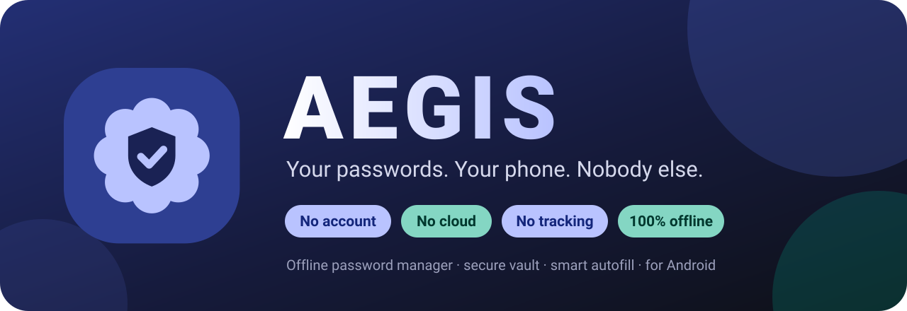
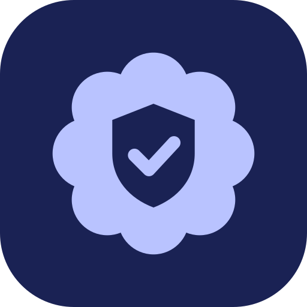
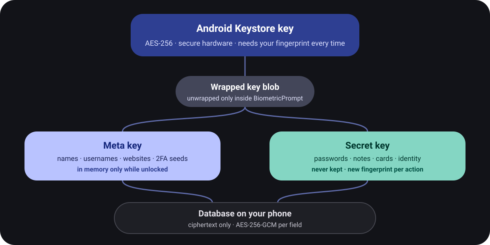

<div align="center">



<br><br>


<br>


<br><br>

**[Features](#-features)** &nbsp;·&nbsp; **[Security](#-how-it-keeps-you-safe)** &nbsp;·&nbsp; **[Install](#-get-it-running)** &nbsp;·&nbsp; **[Build](#-build-from-source)** &nbsp;·&nbsp; **[Author](#-author)**

</div>

<br>

> **AEGIS** is named after the divine shield of Greek mythology. It keeps every password on your
> phone, sealed by your fingerprint, and it has no way to talk to the internet. No sign-up, no
> servers, no "forgot password" backdoor.

<br>

## ✨ Features

<table>
<tr>
<td width="33%" valign="top">

### 🔐 Fingerprint vault
The key lives in secure hardware and refuses to work without a real fingerprint match.

</td>
<td width="33%" valign="top">

### ⚡ Smart autofill
Fills logins in apps and browsers, handles multiple accounts, and offers to save new ones.

</td>
<td width="33%" valign="top">

### 🎲 Password generator
Random passwords and memorable passphrases with a live strength meter.

</td>
</tr>
<tr>
<td valign="top">

### ⏱️ Authenticator
Built-in 2FA codes (TOTP), generated offline.

</td>
<td valign="top">

### 🩺 Security dashboard
Finds weak, reused, duplicate and old passwords and gives you a score.

</td>
<td valign="top">

### 💳 More than logins
Secure notes, payment cards and identity documents.

</td>
</tr>
<tr>
<td valign="top">

### 💾 Encrypted backups
One file, protected by its own password. You decide where it goes.

</td>
<td valign="top">

### 🚨 Auto-lock
Locks on screen-off, when you leave, or after idle time. Emergency Lock is one tap.

</td>
<td valign="top">

### 🧹 Clipboard guard
Copied secrets are hidden from previews and wiped after a timer.

</td>
</tr>
</table>

<br>

## 🚫 What AEGIS will never do

| | |
|:--|:--|
| ❌ **Ask for an account** | No email, no registration, no profile. |
| ❌ **Use the cloud** | The app does not request the `INTERNET` permission. |
| ❌ **Track you** | No analytics, no ads, no crash reporters. |
| ❌ **Pretend to recover a lost vault** | Only *your* encrypted backup can bring it back. |

<br>

## 🎨 Design



Built in Google's **Material 3 Expressive** style: tonal colour blocks, big rounded shapes,
scalloped icon badges, buttons that change shape as you press them, and springy tabs.

Set in **Google Sans Flex**, with **Google Sans Code** for passwords and codes.
Dark theme first, plus a light theme and optional Material You wallpaper colours.

<br clear="right">

## 🛡️ How it keeps you safe

<div align="center">

</div>

<br>

- **The fingerprint prompt is not a gate in front of readable data.** Without a real match, the
  phone's secure hardware refuses to decrypt the keys. There is nothing in the app to bypass.
- **Passwords need a fresh fingerprint every time.** Reveal, copy, edit, save, autofill, health
  check and export each re-derive the secret key, then throw it away.
- **Every field is AES-256-GCM** with its own random nonce, bound to its own row so entries can't be swapped.
- **Change your fingerprints and the key is gone.** That's by design. AEGIS then offers two
  honest choices: restore your backup, or start empty.

<details>
<summary><b>Backup format</b></summary>

<br>

`AEGISBK1 | version | created | iterations | salt | nonce | AES-256-GCM ciphertext`

The key is derived with PBKDF2-HMAC-SHA256 (600,000 iterations, random 16-byte salt). The header
is authenticated, so the file can't be altered without detection. A wrong password and a
damaged file fail the same way.

</details>

<details>
<summary><b>Autofill matching rules</b></summary>

<br>

In known browsers AEGIS matches the page's registrable domain against the saved URL. In other
apps it only offers logins you linked to that app. An unknown app that merely *claims* to show
`google.com` never receives Google credentials.

</details>

Found a vulnerability? See **[SECURITY.md](SECURITY.md)**.

<br>

## 🚀 Get it running

**1.** Install the APK (or [build it yourself](#-build-from-source))

```bash
adb install AEGIS-1.2.0-release.apk
```

**2.** Enrol a fingerprint in Android settings, open AEGIS, tap **Create vault**

**3.** Turn on autofill: **Settings → General → Autofill service**, then pick AEGIS
<br>&nbsp;&nbsp;&nbsp;&nbsp;&nbsp;<sub>In Chrome, also enable <i>Settings → Autofill services → Autofill using another service</i></sub>

**4.** Make a backup: **Settings → Backup → Create backup**, and keep the `.aegis` file off the phone

> [!WARNING]
> A forgotten backup password can't be recovered by anyone.

<br>

## 🔨 Build from source

Needs **JDK 17** and the **Android SDK** (platform 35). Android Studio opens the folder directly.

```bash
./gradlew :app:assembleRelease
```

```bash
./gradlew :app:testDebugUnitTest
```

On Windows use `gradlew.bat`. APKs land in `app/build/outputs/apk/`.

<details>
<summary><b>Release signing</b></summary>

<br>

Without configuration, release builds are signed with the Android debug key so they can be
sideloaded. For a real release, create your own keystore and a `keystore.properties` file in
the project root (both are git-ignored):

```
storeFile=aegis-release.jks
storePassword=...
keyAlias=aegis
keyPassword=...
```

</details>

<br>

## 🧰 Tech stack

<div align="center">


**Kotlin** · **Jetpack Compose** · **Material 3** · **Room** · **Android Keystore** · **BiometricPrompt** · **Autofill Framework**

</div>

<details>
<summary><b>Project structure</b></summary>

<br>

```
app/src/main/java/com/aegis/vault/
  AegisApp.kt     Application, preferences, auto-lock, clipboard guard
  crypto/         AES-GCM, Keystore key, BiometricPrompt wrapper, backup format
  data/           Room database (ciphertext only), models, vault session
  logic/          Generator, word list, TOTP, health analysis, autofill matching
  autofill/       AutofillService, form parser, fill and save screens
  quick/          Quick Vault sheet and Quick Settings tile
  ui/             Compose UI: theme, navigation and every screen
app/src/test/     Unit tests
branding/         Logo concepts (SVG)
```

</details>

<br>

## 📋 Status

> [!NOTE]
> **Pre-release.** It builds, 32 of 32 unit tests pass (encryption, backup format, TOTP vectors,
> generator, health, matching) and lint is clean. The parts that need real hardware —
> fingerprint prompt, Keystore, autofill inside other apps — still need on-device verification.

<details>
<summary><b>Device test checklist</b></summary>

<br>

- [ ] Onboarding refuses to create a vault with no fingerprint enrolled
- [ ] After a force-stop the vault is locked and opens only with a fingerprint
- [ ] Add, edit, favourite, search and delete each entry type
- [ ] Reveal and copy both ask for a fingerprint; the clipboard clears on time
- [ ] Emergency Lock locks and does not re-prompt by itself
- [ ] Every auto-lock setting works; screen-off always locks
- [ ] Recents screen and screenshots show nothing
- [ ] Autofill works in a native app, Chrome and Samsung Internet
- [ ] Authenticator codes match another authenticator
- [ ] Security check finds a weak and a reused password
- [ ] Backup → erase → restore works; a wrong backup password is rejected
- [ ] Adding a fingerprint in Android settings invalidates the vault, and the backup restores it

</details>

<details>
<summary><b>Known limitations</b></summary>

<br>

- A rooted or compromised device defeats any app-level protection.
- Clipboard auto-clear is a timer in the app; if Android kills the app first, the system's own expiry applies.
- Apps that draw their own text fields expose nothing to autofill. Use Quick Vault there.
- Domain matching uses a short built-in suffix list, not the full Public Suffix List.
- App identity is the package name; signing-certificate checks are not implemented.
- No favicons (they would need the network) and no QR scanner (it would need the camera).
- The passphrase list has 554 words; use six or more for important accounts.

</details>

<br>

## 👤 Author

<div align="center">

<a href="https://github.com/tamimrijan"></a>

### Tamim Ahmed Rijan

<a href="https://github.com/tamimrijan"></a>
<a href="https://www.instagram.com/tamim_ahmed_rijan/"></a>

</div>

<br>

## 📄 License

[MIT](LICENSE) © 2026 Tamim Ahmed Rijan

Fonts: [Google Sans Flex](https://github.com/googlefonts/googlesans-flex) and Google Sans Code, SIL Open Font License 1.1 (see [`licenses/`](licenses)).

<br>

<div align="center">

**No cloud. No registration. No recovery service.**
<br>
<sub>Just privacy, security, and complete ownership of your digital secrets.</sub>

<br><br>

⭐ **Star the repo if AEGIS is useful to you**

</div>
